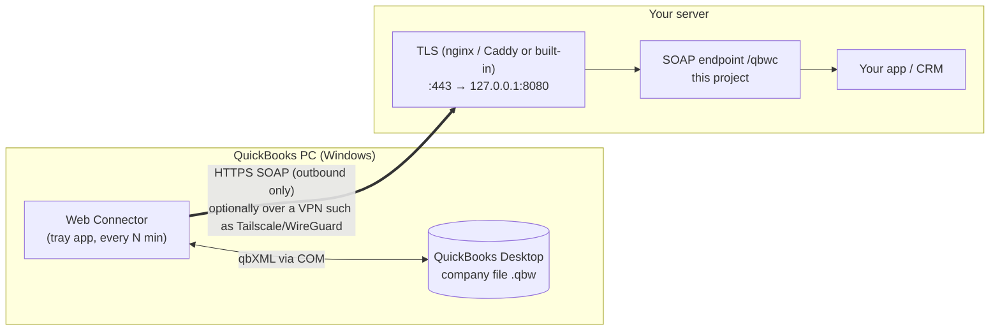
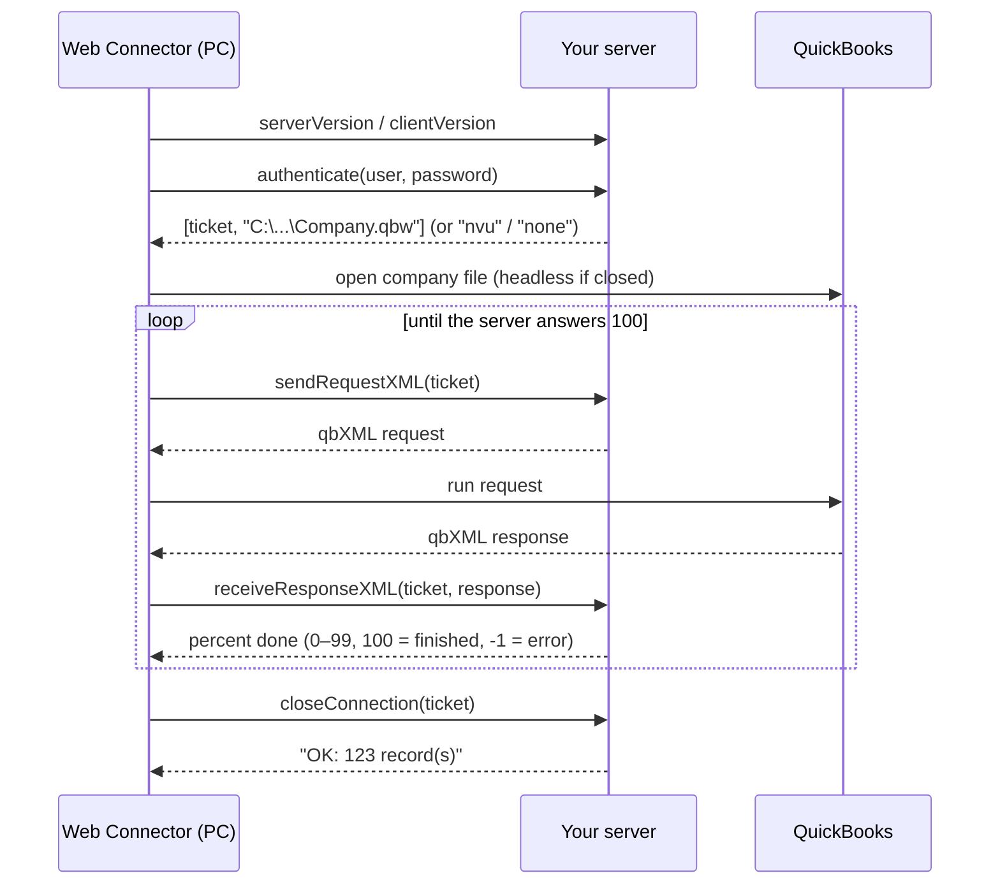

# quickbooks-web-connector

[](https://github.com/AbdurahmanZA/quickbooks-web-connector/actions/workflows/test.yml) [](LICENSE)

A small, readable Node.js server for the **QuickBooks Desktop Web Connector**
(QBWC). It shows the whole method for getting data out of QuickBooks Desktop
and into your own web app or CRM: the SOAP endpoint, login, paged qbXML
queries and the regional-number trap. It is short enough to read in one
sitting.

One runtime dependency (`fast-xml-parser`), no native modules, and
`node --test` tests for each part.

---

## How it works

QuickBooks Desktop has no web API you can call. Instead, **the PC running
QuickBooks calls your server.** Intuit's free *Web Connector* sits in the
Windows tray, wakes every N minutes, logs in to your SOAP endpoint and asks
"what do you want?". Your server returns qbXML requests. Web Connector runs
them against QuickBooks and posts the answers back. Your server never has to
connect *to* the PC, so the shop needs no open ports.



### One session



## Quick start

Requires Node.js 22.13 or later.

```bash
npm install
npm test

# hash the password Web Connector will log in with
node bin/qbwc.js hash-password

# make the .qwc file to load into Web Connector on the QuickBooks PC
node bin/qbwc.js make-qwc --name "My App Sync" --url https://qb.example.com/qbwc --user sync_user > myapp.qwc

# run the demo server (customers are pulled into memory and logged)
QBWC_PASSWORD_HASH='scrypt$...' QBWC_COMPANY_FILE='C:\Path\To\Company.qbw' npm start
```

**Environment:** `QBWC_USER` (sync_user), `QBWC_PASSWORD_HASH`,
`QBWC_COMPANY_FILE`, `PORT` (8080), `HOST` (127.0.0.1), `TLS_CERT`, `TLS_KEY`.

Web Connector only accepts `https://` URLs (plain `http://` works for
`localhost` only). Put a reverse proxy in front:

```nginx
server {
  listen 443 ssl;
  server_name qb.example.com;
  ssl_certificate     /etc/ssl/qb.example.com/fullchain.pem;
  ssl_certificate_key /etc/ssl/qb.example.com/privkey.pem;
  client_max_body_size 64m;              # a full pull can be large
  location /qbwc    { proxy_pass http://127.0.0.1:8080; proxy_read_timeout 300s; }
  location /support { proxy_pass http://127.0.0.1:8080; }
}
```

or let the server do TLS itself with `TLS_CERT=cert.pem TLS_KEY=key.pem npm start`.
The PC must trust the certificate.

## On the QuickBooks PC

1. Open QuickBooks **as the Admin user**, with the company file open.
2. Web Connector → **Add an application** → choose the `.qwc` file.
3. When QuickBooks asks, choose **"Yes, whenever this QuickBooks company file is open"**.
4. QuickBooks → Edit → Preferences → Integrated Applications → Company
   Preferences → your app → Properties → tick **"Allow this application to
   login automatically"**. Without this, syncing only works while somebody
   has QuickBooks open.
5. In Web Connector, enter the password, tick **Auto-Run** and set the interval.
6. Close QuickBooks completely and wait for one run. A run that finishes with
   QuickBooks closed shows the setup is right.

## Using it with your own app

The connector doesn't know about databases. You give it four callbacks
(see [`examples/custom-crm.js`](examples/custom-crm.js) and
[`src/demo-app.js`](src/demo-app.js)):

```js
const { createConnector, createServer } = require('quickbooks-web-connector');

const connector = createConnector({
  authenticate: async (username, password) => ({ id, companyFile }) /* or null */,
  requestsFor:  async (account, { ticket }) => [ /* qbXML strings */ ],
  onResponse:   async (account, results, { ticket }) => { /* save rows */ },
  onSessionEnd: async (account, { ok, errors, records, startedAt }) => { /* move cursor if ok */ },
});
createServer(connector).listen(8080, '127.0.0.1');
```

`results` is a flat list:
`{ type: 'CustomerQueryRs', requestID, statusCode, statusSeverity, statusMessage, iteratorID, remaining, rows: [...] }`.

The connector handles tickets, paging (`iterator="Continue"`), progress
percentages, error codes and session clean-up for you.

## Layout

| Path | What it is |
|---|---|
| `src/connector.js` | The eight QBWC methods and the session loop |
| `src/soap.js`, `src/server.js` | SOAP envelope in and out, HTTP(S) server, WSDL |
| `src/sessions.js` | Random tickets, per-run request queue, progress |
| `src/auth.js` | scrypt password hashing (built-in `crypto`) |
| `src/decimal.js` | `parseQbDecimal()` for amounts like `12 345,67` |
| `src/qbxml/` | A paged customer query, the request envelope and the response parser |
| `src/demo-app.js` | In-memory example app: one account, customers |
| `src/qwc.js`, `bin/qbwc.js` | `.qwc` generator and a small CLI |
| `test/` | SOAP round trip, auth, paging, `.qwc`, decimals |

## Traps this code handles

| Symptom | Cause | Where |
|---|---|---|
| `0x80040408` "Could not start QuickBooks" when QuickBooks is closed | `authenticate` returned `''` instead of the company file path | `connector.authenticate` |
| Amounts short by cents | Regional settings: QuickBooks sends `12 345,67` | `parseQbDecimal` |
| Only the first 500 rows arrive | Query not paged | iterator handling in `receiveResponseXML` |
| Web Connector stops one request early | Progress rounded up to 100 while requests remain | `percentComplete` |
| A failed query silently skips a window | Error response treated as "0 rows" | errors keep the cursor in place |
| `0x80040400` "error parsing the provided XML" | Elements out of schema order | builders emit a fixed order |

This repository covers reading data. Writing back to QuickBooks (Add/Mod
requests) needs more care than fits here: a queue, idempotency, and a plan
for answers lost in transit.

## Licence

[MIT](LICENSE) © 2026 Abdurahman Solomon
